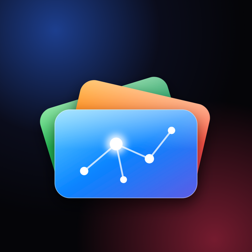
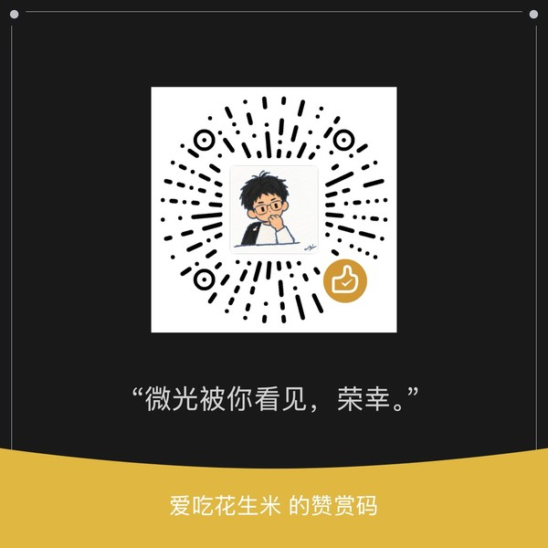

<h1 align="center">账号星图 · Atlas</h1>

这个邮箱注册过什么？那个手机号绑了哪些 App？一眼看清。

网页 · iOS · 安卓 三端可用，iOS 用 SwiftUI、安卓用 Jetpack Compose 原生编写，数据加密同步互通

  <a href="https://huichen.dev/account-atlas/">在线使用</a> ·
  <a href="https://github.com/Ckxkx/account-atlas/releases/latest">下载 App（安卓 APK · iOS IPA）</a> ·
  备用下载：<a href="https://huichen.dev/downloads/Atlas.apk">APK</a> · <a href="https://huichen.dev/downloads/Atlas.ipa">IPA</a>

  
  
  

> **开源**：完整源码和提交历史都在本仓库，欢迎[提 Issue](https://github.com/Ckxkx/account-atlas/issues)和 Pull Request。项目自己的 Logo 和图标不在开放范围内，具体见[许可](#许可)。
> 官方安装包只从本仓库 [Releases](https://github.com/Ckxkx/account-atlas/releases/latest) 和 [huichen.dev](https://huichen.dev/) 发布。App 永久免费，任何收费渠道都不是官方的。

## 它能做什么
- **卡包**：每个邮箱、手机号都是一张 Wallet 风格的卡，左右翻看，手机号做成 SIM 卡
- **点选添加**：内置 100+ 常用网站和 App（官方图标），多选后再选用哪个邮箱或手机号，同一网站可记多个账号名
- **关系图**：左边身份、右边 App，自动连线，点卡片只看它连着的
- **深色 / 浅色**：从按钮扩散开的圆形切换
- **隐私模式**：号码和账号名一键打码，截图分享也安心
- **加密同步（可选）**：数据用你的同步密码在本地 AES-GCM 加密后，存进你自己的 Gitee（国内直连）或 GitHub 私密 Gist
- 拖动排序、撤销删除、JSON 导入导出、离线可用

## 下载
最新版在 [Releases](https://github.com/Ckxkx/account-atlas/releases/latest)，同一个版本里有两个文件：
- **Atlas.apk**：安卓（Android 8.0+）原生版，下载后直接安装；以后的版本签名相同，覆盖安装，数据保留
- **Atlas.ipa**：iOS 原生版（未签名），用 SideStore / 爱思助手 / Sideloadly 等自签后安装

GitHub 下载慢的话，可以从 huichen.dev/downloads 下载：[Atlas.apk](https://huichen.dev/downloads/Atlas.apk) · [Atlas.ipa](https://huichen.dev/downloads/Atlas.ipa)。只认这两个地方，别处的都不是官方包。

## 不想自签？用网页版装到桌面（PWA）
网页版本身就能“安装”成 App：有桌面图标，全屏打开没有地址栏，断网也能用。

**iPhone / iPad**
1. 用 **Safari** 打开 https://huichen.dev/account-atlas/
2. 点「分享」按钮（方框加向上的箭头；iOS 26 先点右下角「⋯」）
3. 往下滑，选「添加到主屏幕」，再点「添加」

**安卓**
1. 用 Chrome 或 Edge 打开同一个网址
2. 右上角「⋮」→「添加到主屏幕」或「安装应用」

数据存在这台设备的浏览器里，换手机前记得用「加密同步」或「导出」备份。

## 隐私
数据默认只存在你自己的设备上，没有任何服务器。**不记录密码**。开启同步时，云端只有加密后的文件。

## 三个版本
| | 网页版 | iOS 原生版 | 安卓原生版 |
|---|---|---|---|
| 技术 | 纯 HTML/CSS/JS，零依赖 | SwiftUI，iOS 17+ | Kotlin + Jetpack Compose，Android 8.0+ |
| 安装 | 打开网址，Safari「添加到主屏幕」 | 从 Releases 下载 IPA，用 SideStore / 爱思助手 / Sideloadly 等自签安装 | 从 Releases 下载 APK 直接安装 |
| 代码 | 根目录 `index.html` `app.js` `styles.css` | `native/` | `android/` |

三个版本的数据格式相同，可以通过同步或 JSON 互通。

## 自己运行 / 构建
- 网页版：`python3 -m http.server 8080`，打开 `http://localhost:8080`
- 安卓版：`cd android && ./gradlew assembleRelease`（JDK 17 + Android SDK）；没有配置签名密钥（`ATLAS_KEYSTORE`）时会自动用调试密钥签名。启动图标只有一个源文件 `android/icon-src/icon-1024.png`，换图后重新构建即可
- iOS 版：需要 macOS + Xcode，用 `swiftc` 编译 `native/*.swift`，步骤见 `.github/workflows/ios.yml`
- 本仓库推送到 `main` 后，GitHub Actions 会自动构建：`web.yml` 部署网页版，`android.yml` 构建签名 APK，`ios.yml` 构建未签名 IPA，并发布到 Releases

二次创作或自己打包发布时，请把 Logo 和应用图标换成你自己的（见[许可](#许可)）。

## 参与
发现 bug、想要新功能，欢迎[提 Issue](https://github.com/Ckxkx/account-atlas/issues)；代码改进欢迎直接提 Pull Request。

## 请我吃包花生米
觉得好用的话，可以用微信扫码赞赏，随意就好。

## 许可
[PolyForm Strict 1.0.0](LICENSE)，版权所有 © 2026 阿chen。
- ✅ 可以：下载、安装，个人非商业使用
- ❌ 不可以：修改、二次创作或基于它做衍生作品
- ❌ 不可以：转载、重新打包或分发（包括上传到其他平台）
- ❌ 不可以：任何商业用途

分享请直接发本仓库链接或 huichen.dev。其他用途请先联系作者。

2026 年 11 月 20 日之前发布的版本按当时的 MIT 许可。
